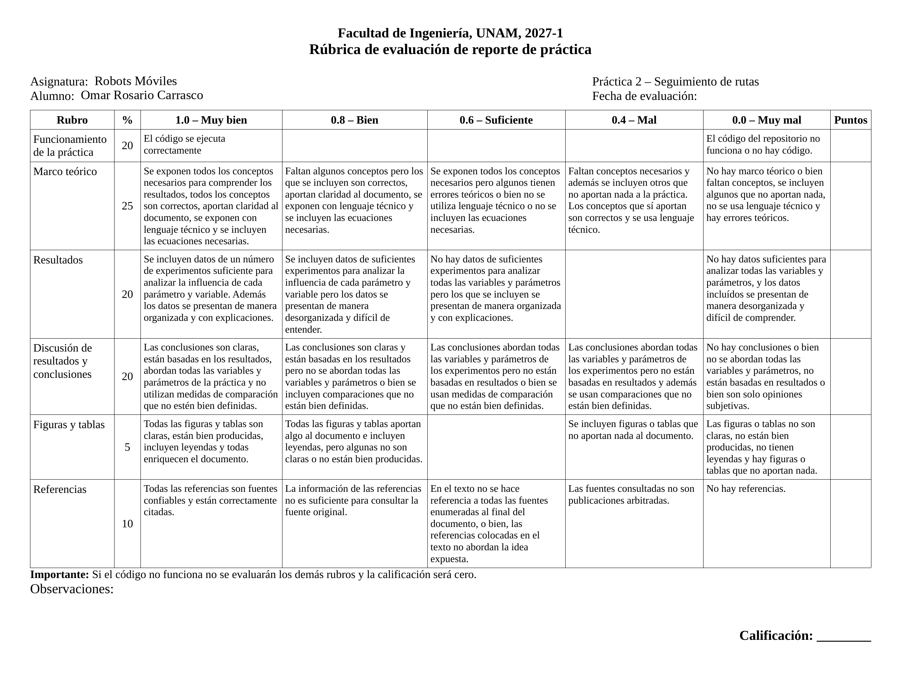
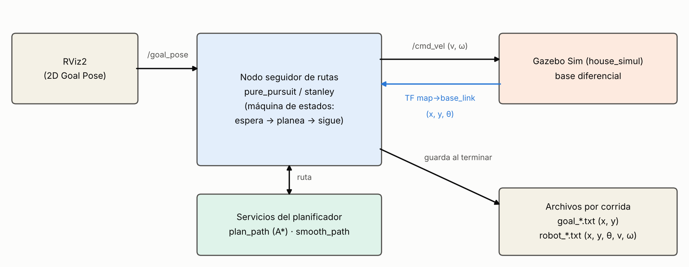
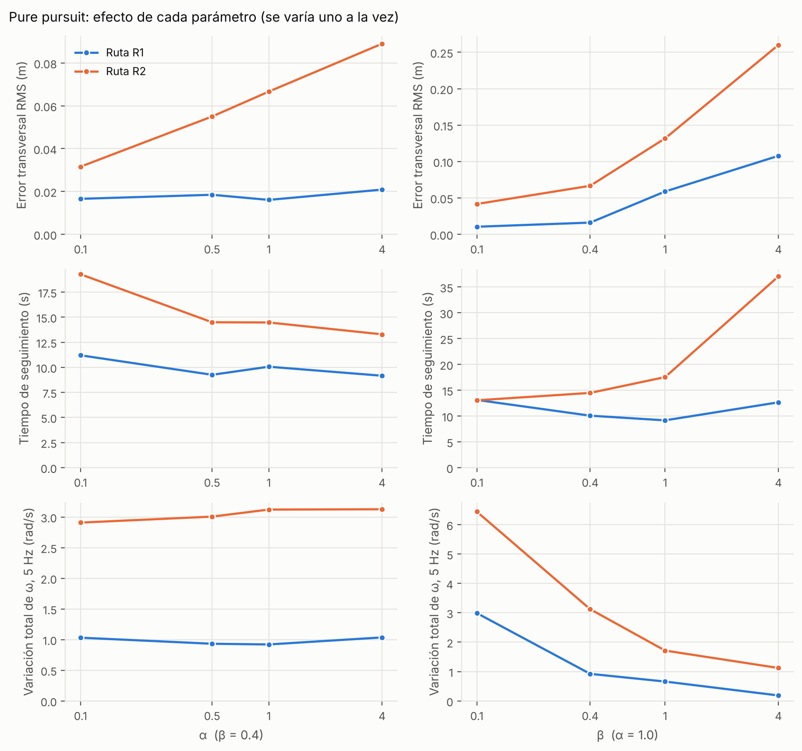
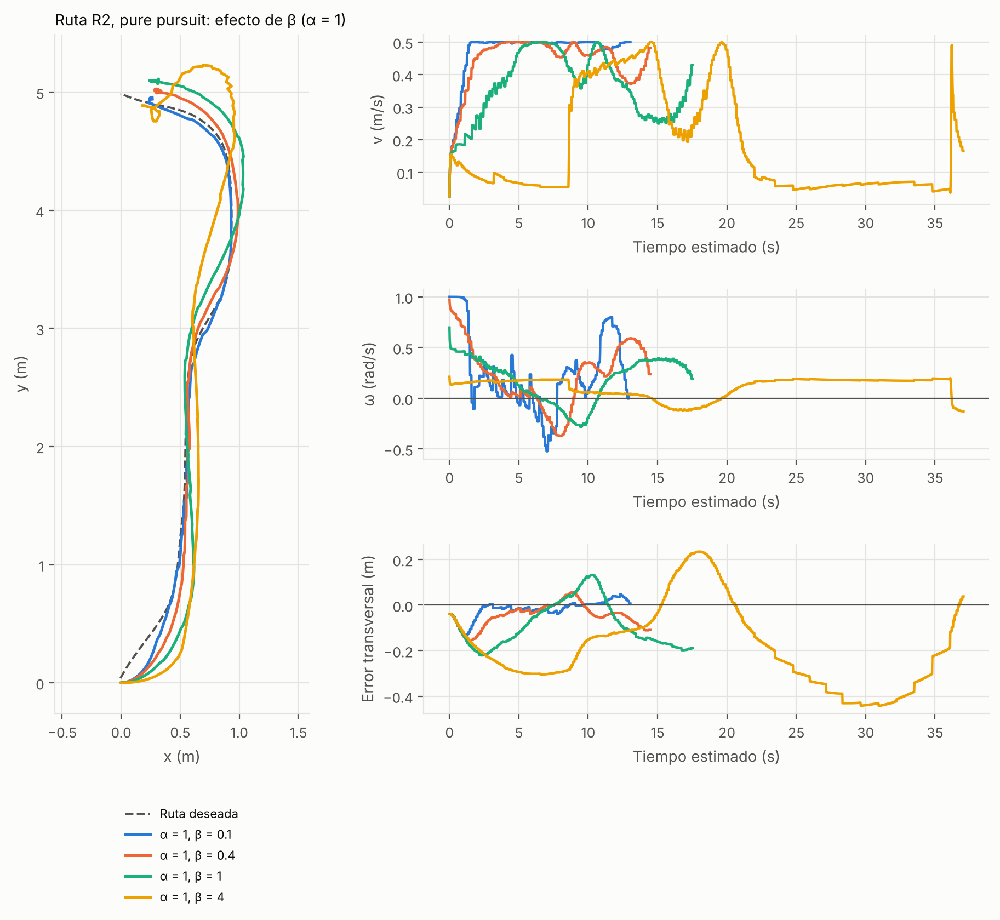
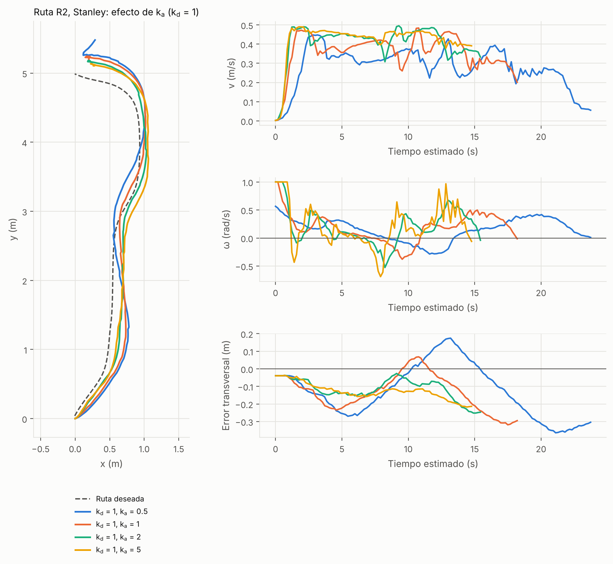
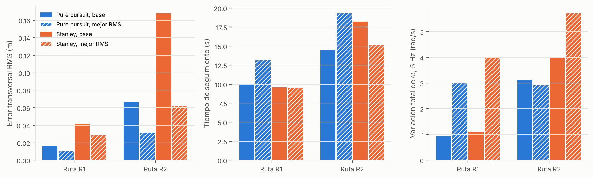
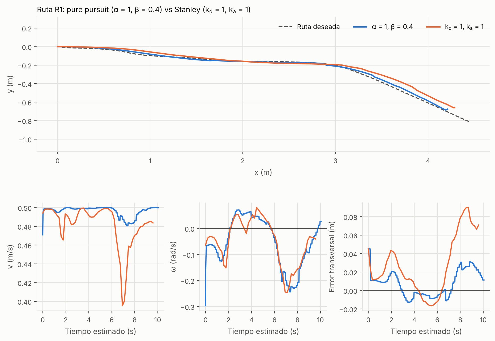
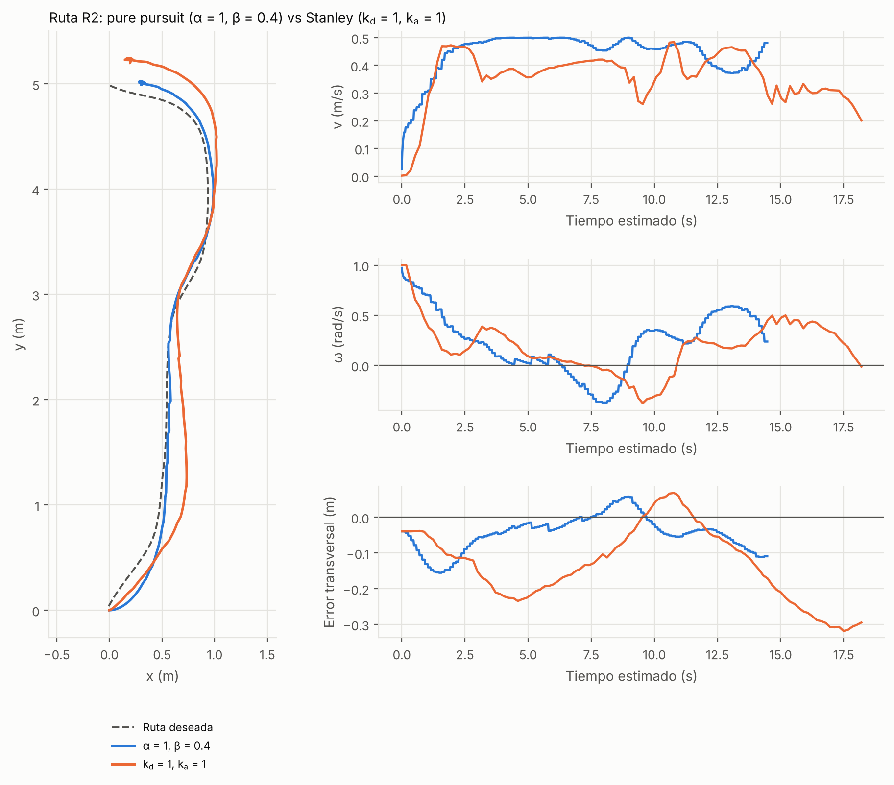
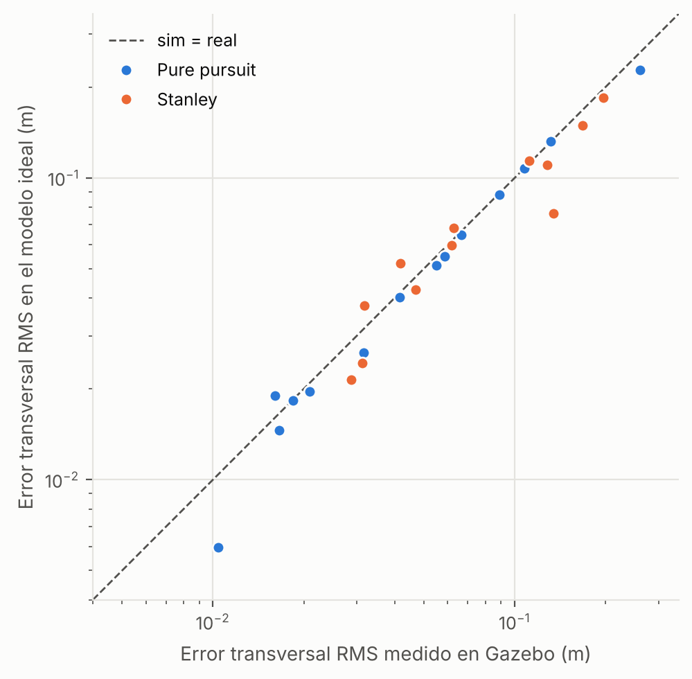

::: {custom-style="RubricaPagina"}
{width=24.4cm}
:::

::: {custom-style="PortadaInst"}
UNIVERSIDAD NACIONAL AUTÓNOMA DE MÉXICO
:::

::: {custom-style="PortadaFac"}
Facultad de Ingeniería
:::

::: {custom-style="PortadaCurso"}
Robots Móviles (Temas Selectos de Mecatrónica II) · Semestre 2027-1
:::

::: {custom-style="Titulo"}
Práctica 2. Seguimiento de rutas
:::

::: {custom-style="Subtitulo"}
Comparación de los algoritmos pure pursuit y Stanley en una base diferencial con ROS 2 y Gazebo
:::

::: {custom-style="PortadaDatos"}
**Alumno:** Omar Rosario Carrasco\
**Profesor:** Dr. Marco Negrete\
**Fecha:** 13 de octubre de 2026
:::

::: {custom-style="ResumenTitulo"}
Resumen
:::

::: {custom-style="ResumenTexto"}
Se implementaron los algoritmos de seguimiento de rutas *pure pursuit* y Stanley para una base diferencial en ROS 2 Jazzy y se compararon en simulación (Gazebo) sobre dos rutas planeadas con A\*. Se realizaron 27 corridas variando, uno a la vez, los parámetros *α* y *β* de pure pursuit y *k*~a~ y *k*~d~ de Stanley. La comparación se basó en tres medidas definidas de antemano: el error transversal RMS (exactitud), el tiempo de seguimiento (rapidez) y la variación total de *ω* (agitación de la señal de control). Con los parámetros base, pure pursuit obtuvo 2.5 veces menos error RMS que Stanley en ambas rutas (0.016 m contra 0.042 m en R1; 0.067 m contra 0.168 m en R2). Un análisis lineal del error transversal muestra que ambas leyes se reducen a un sistema de segundo orden y que la diferencia se debe, sobre todo, a la ganancia transversal efectiva de cada configuración, no a la estructura del algoritmo.
:::

# 1. Introducción

**Contexto.** La navegación autónoma de un robot móvil suele dividirse en cuatro problemas: estimar su pose (localización), planear una ruta libre de colisiones, seguir esa ruta y reaccionar ante obstáculos no previstos. Este reporte se ocupa del tercero. Una ruta es sólo una secuencia de configuraciones que lleva al robot del inicio a la meta; si además se expresa en función del tiempo (una ruta más una escala de tiempo) se tiene una trayectoria [[lynch|§9.1]]. Planear rutas es relativamente barato, pero el robot no las recorre por sí solo: se necesita una ley de control que convierta la ruta en comandos de velocidad lineal *v* y angular *ω*. En ROS 2 [[macenski]] y en el simulador Gazebo [[koenig]] este problema se puede estudiar con una base diferencial simulada, sin riesgo para el equipo.

**Motivación.** Existen varias estrategias de seguimiento de rutas. *Pure pursuit* persigue un único punto de la ruta; *Stanley* corrige directamente el error de orientación y el error transversal respecto a la ruta. Ambas son sencillas de programar, pero cada una tiene constantes de sintonización cuyo efecto no es evidente: un valor que reduce el error de seguimiento puede volver más brusca la señal de control o hacer más lento al robot. Elegir entre algoritmos o ajustar sus constantes sin una medida cuantitativa no es una decisión informada.

**Planteamiento del problema.** Dada una ruta suave en un mapa conocido y un robot diferencial cuyas velocidades están acotadas (|*v*| ≤ *v*~max~, |*ω*| ≤ *ω*~max~), se requieren leyes de control que lo hagan recorrer la ruta con la mayor exactitud posible, y se desea saber cómo influyen los parámetros de cada ley en la exactitud, en el tiempo de recorrido y en el comportamiento de *v* y *ω*.

**Objetivos.** El objetivo general es comparar el desempeño de pure pursuit y Stanley con diferentes parámetros. Los objetivos particulares son: (1) implementar ambas leyes de control en los nodos de ROS 2 de la práctica; (2) diseñar y ejecutar experimentos en dos rutas, variando un parámetro a la vez; (3) definir medidas cuantitativas de comparación; (4) analizar tanto el seguimiento de la ruta como las señales de control *v* y *ω*; y (5) explicar los resultados con el marco teórico.

El documento se organiza así: la sección 2 presenta el marco teórico (modelo cinemático, seguimiento de rutas, las dos leyes, la dinámica del error transversal y las medidas de comparación); la sección 3 describe la plataforma y el diseño de los experimentos; la sección 4 reporta y discute los resultados; y la sección 5 presenta las conclusiones y el trabajo futuro.

# 2. Marco teórico

## 2.1 Modelo cinemático de la base diferencial

Una base diferencial tiene dos ruedas motrices coaxiales con velocidades independientes y una o más ruedas de apoyo. Su movimiento se modela como el de un uniciclo con configuración *q* = (*x*, *y*, *θ*), donde (*x*, *y*) es la posición del centro del eje y *θ* la orientación respecto al eje *x* global [[tzafestas|§2.3.1, pp. 41–42]]. Con la velocidad lineal *v* y la velocidad angular *ω* como entradas de control:

::: {custom-style="Ecuacion"}
§T $\dot{x}=v\cos\theta,\qquad \dot{y}=v\sin\theta,\qquad \dot{\theta}=\omega$ §T{{eq:unicycle}}
:::

El robot no puede desplazarse lateralmente, lo que se expresa con la restricción no holónoma [[tzafestas|p. 41]]

::: {custom-style="Ecuacion"}
§T $-\dot{x}\sin\theta+\dot{y}\cos\theta=0$ §T{{eq:nonholo}}
:::

Las velocidades de las ruedas derecha e izquierda, *v*~r~ y *v*~l~, se relacionan con las entradas mediante *v* = (*v*~r~ + *v*~l~)/2 y *ω* = (*v*~r~ − *v*~l~)/*b*, con *b* la distancia entre ruedas [[tzafestas|§2.3.2, pp. 43–44]]. Por ello basta con calcular (*v*, *ω*). Trabajar sólo con la cinemática es válido cuando la dinámica del vehículo no es preponderante y los lazos de velocidad de bajo nivel responden bien [[samson|§49.2.1, p. 1238]]; ésta es la hipótesis de la práctica, junto con que la pose del robot es conocida.

## 2.2 Seguimiento de rutas

En control de robots móviles se distinguen tres problemas: estabilizar una postura (llegar a una configuración), seguir una trayectoria (cumplir una ley horaria) y seguir una ruta, en la que no se prescribe cuándo se debe pasar por cada punto [[lynch|§13.3.4]]. En el seguimiento de rutas el objetivo es anular la distancia entre el robot y el punto más cercano de la curva [[samson|§49.1.1, p. 1237]]. De ahí que las cantidades naturales sean el *error transversal* (distancia lateral del robot a la ruta) y el *error de orientación* (diferencia entre la orientación del robot y la tangente de la ruta en el punto más cercano).

Hay dos formas de abordarlo. La primera reduce el problema a una secuencia de problemas de posición: se aplica un control de posición a cada punto de la ruta (en [[siegwart|§3.6, pp. 83–86]] se presenta un control de posición para esta cinemática en coordenadas polares). La segunda retroalimenta directamente los errores respecto a la ruta; la ley de seguimiento de caminos de [[samson|§49.3.2, p. 1241]] combina precisamente un término de orientación y un término de distancia. Pure pursuit pertenece a la primera familia y Stanley a la segunda. La {{figref:geom}} muestra las variables de cada una.

{width=15.5cm}

## 2.3 Pure pursuit

La idea original es elegir un punto de la ruta a una distancia de anticipación *L* del vehículo y avanzar por el arco de circunferencia que lo une con ese punto. Si *ε* es el ángulo entre la orientación del vehículo y la línea que une ambos puntos, la curvatura de ese arco es [[tzafestas|Ej. 2.3, pp. 53–55]]

::: {custom-style="Ecuacion"}
§T $\kappa=\dfrac{2\sin\varepsilon}{L}\approx\dfrac{2\varepsilon}{L}$ §T{{eq:kappapp}}
:::

es decir, una ley proporcional al error angular. La versión del curso aplica a cada punto de la ruta el control de posición para base diferencial. Con la pose del robot (*x*~r~, *y*~r~, *θ*~r~) y el punto meta (*x*~g~, *y*~g~), el error de ángulo es

::: {custom-style="Ecuacion"}
§T $e_a=\operatorname{atan2}(y_g-y_r,\;x_g-x_r)-\theta_r,\qquad e_a\leftarrow(e_a+\pi)\bmod 2\pi-\pi$ §T{{eq:ea}}
:::

y las velocidades son

::: {custom-style="Ecuacion"}
§T $v=v_{\max}\,e^{-e_a^{2}/\alpha}$ §T{{eq:vpp}}
:::

::: {custom-style="Ecuacion"}
§T $\omega=\omega_{\max}\left(\dfrac{2}{1+e^{-e_a/\beta}}-1\right)=\omega_{\max}\tanh\!\left(\dfrac{e_a}{2\beta}\right)$ §T{{eq:wpp}}
:::

donde *v*~max~ y *ω*~max~ son las velocidades máximas del robot y *α* y *β* son constantes de sintonización. La igualdad con la tangente hiperbólica se obtiene directamente de la definición de tanh y es la forma que se programó, porque evita el desbordamiento de la exponencial cuando *β* es pequeño. El envoltorio de la {{eqref:ea}} mantiene *e*~a~ en [−π, π).

El punto meta no es fijo: se avanza al siguiente punto de la ruta cuando la distancia al punto actual es menor que 0.3 m. Como los puntos están separados unos 0.05 m, el punto perseguido queda siempre a una distancia de anticipación efectiva *L* ≈ 0.3 m.

**Papel de los parámetros.** La {{eqref:vpp}} reduce la velocidad cuando el robot está desalineado: *v* cae a *v*~max~/*e* cuando |*e*~a~| = √*α*. Por tanto *α* no actúa sobre la dirección, sino que fija cuánto desalineamiento tolera el robot antes de frenar. En la {{eqref:wpp}}, para errores pequeños tanh(*x*) ≈ *x*, de modo que

::: {custom-style="Ecuacion"}
§T $\omega\approx K\,e_a,\qquad K=\dfrac{\omega_{\max}}{2\beta}$ §T{{eq:Kpp}}
:::

es decir, un controlador proporcional cuya ganancia *K* disminuye al aumentar *β*; la señal satura (96 % de *ω*~max~) cuando |*e*~a~| ≥ 4*β*. La {{tabref:ppparam}} resume estas cantidades para los valores usados. Con la ganancia *K* el error angular decae con constante de tiempo 2*β*/*ω*~max~; a *v*~max~ = 0.5 m/s, el robot avanza *β* metros mientras corrige (0.1, 0.4, 1 y 4 m). Cuando este valor supera el radio de las curvas de la ruta (hasta 0.54 m en R2, sección 3.2), el robot no alcanza a corregir a tiempo y describe curvas amplias.

{{TAB:ppparam}}

Table: **Tabla {{tab:ppparam}}.** Cantidades derivadas de los parámetros de pure pursuit para *ω*~max~ = 1 rad/s y *v*~max~ = 0.5 m/s.

## 2.4 Stanley

El controlador Stanley se desarrolló para el vehículo autónomo que ganó el DARPA Grand Challenge [[thrun06]]. Calcula el ángulo de dirección de las llantas delanteras como *δ* = *ψ* + arctan(*k e*/*v*), donde *ψ* es el error de orientación respecto a la tangente de la ruta, *e* el error transversal medido en el eje delantero, *v* la velocidad y *k* una ganancia [[thrun06]], [[hoffmann]]. El primer término alinea al vehículo con la ruta; el segundo lo acerca a ella, con efecto mayor a baja velocidad. En [[hoffmann]] se analiza su estabilidad y se valida en un vehículo real.

La versión de la práctica lo adapta a una base diferencial, donde la entrada de dirección es *ω* y no un ángulo de llantas. Sea (*x*~i~, *y*~i~) el punto de la ruta más cercano al robot y *θ*~i~ el ángulo de la ruta en ese punto, estimado con los puntos vecinos:

::: {custom-style="Ecuacion"}
§T $\theta_i=\operatorname{atan2}(y_{i+1}-y_{i-1},\;x_{i+1}-x_{i-1})$ §T{{eq:thetai}}
:::

Los errores son

::: {custom-style="Ecuacion"}
§T $\theta_e=\theta_i-\operatorname{atan2}(y_r-y_i,\;x_r-x_i)$
:::

::: {custom-style="Ecuacion"}
§T $\delta_t=\operatorname{sgn}(\theta_e)\sqrt{(x_r-x_i)^2+(y_r-y_i)^2}$
:::

::: {custom-style="Ecuacion"}
§T $\delta_\theta=\theta_i-\theta_r$ §T{{eq:errst}}
:::

con *δ*~t~ el error transversal con signo (positivo si el robot está a la derecha de la ruta) y *δ*~θ~ el error de orientación, envuelto a [−π, π). Las señales de control son

::: {custom-style="Ecuacion"}
§T $v=v_{\max}\,e^{-k_v(\delta_t^{2}+\delta_\theta^{2})}$ §T{{eq:vst}}
:::

::: {custom-style="Ecuacion"}
§T $\omega=\max\!\big(-\omega_{\max},\,\min(\omega_{\max},\;k_a\,\delta_\theta+k_d\,\delta_t)\big)$ §T{{eq:wst}}
:::

Comparada con la ley original, la {{eqref:wst}} es su linealización para errores pequeños (arctan *x* ≈ *x*), con el efecto de la velocidad absorbido en la ganancia *k*~d~ y con saturación en ±*ω*~max~. *k*~a~ pondera el error de orientación, *k*~d~ el error transversal y *k*~v~ (constante, igual a 5 en todos los experimentos) controla cuánto frena el robot cuando los errores son grandes. No hay término de curvatura de la ruta (prealimentación), una diferencia que se retoma en la sección 2.5.

## 2.5 Dinámica del error transversal cerca de la ruta

Para comparar analíticamente las dos leyes se linealizan cerca de una ruta recta (derivación propia). Sea *e* el desplazamiento lateral del robot y *ψ* su desviación angular respecto a la ruta, con *v* ≈ *v*~max~ (la exponencial de las ecuaciones {{ref:vpp}} y {{ref:vst}} vale casi 1 para errores pequeños). De la cinemática {{ref:unicycle}}, d*e*/d*t* = *v* sin *ψ* ≈ *v ψ* y d*ψ*/d*t* = −*ω*. En Stanley, *ω* = *k*~a~ *ψ* + *k*~d~ *e*, de donde

::: {custom-style="Ecuacion"}
§T $\ddot{e}+k_a\,\dot{e}+k_d\,v\,e=0$ §T{{eq:lin_st}}
:::

En pure pursuit, con el punto meta sobre la ruta a distancia *L*, *e*~a~ ≈ −*e*/*L* − *ψ* y *ω* = *K e*~a~, por lo que

::: {custom-style="Ecuacion"}
§T $\ddot{e}+K\,\dot{e}+\dfrac{K\,v}{L}\,e=0$ §T{{eq:lin_pp}}
:::

Ambas tienen la forma de un sistema de segundo orden,

::: {custom-style="Ecuacion"}
§T $\ddot{e}+2\zeta\omega_n\,\dot{e}+\omega_n^{2}\,e=0$ §T{{eq:segundo}}
:::

con frecuencia natural *ω*~n~ y amortiguamiento *ζ*:

::: {custom-style="Ecuacion"}
§T $\text{Stanley:}\quad\omega_n=\sqrt{k_d\,v},\quad\zeta=\dfrac{k_a}{2\sqrt{k_d\,v}}$
:::

::: {custom-style="Ecuacion"}
§T $\text{Pure pursuit:}\quad\omega_n=\sqrt{\dfrac{K\,v}{L}},\quad\zeta=\dfrac{K}{2\,\omega_n}$ §T{{eq:wnzeta}}
:::

El sobreimpulso del error ante un desfase inicial es *S* = exp(−*πζ*/√(1 − *ζ*²)) para *ζ* < 1, resultado clásico de los sistemas de segundo orden (nulo si *ζ* ≥ 1). Las ecuaciones muestran que pure pursuit es una ley tipo Stanley con ganancia de orientación *k*~a,eq~ = *K* y ganancia transversal *k*~d,eq~ = *K*/*L*. Con *L* ≈ 0.3 m, la ganancia transversal efectiva de pure pursuit es 3.3 veces su ganancia angular, mientras que en la versión de Stanley de la práctica ambas se eligen por separado. Esto permite comparar configuraciones de ambos algoritmos con la misma cantidad, *k*~d,eq~ (sección 4.5).

En una curva de curvatura *κ*, el robot debe girar con *ω* = *κ v*. Como Stanley no tiene prealimentación, con *δ*~θ~ ≈ 0 esto exige un error transversal de equilibrio

::: {custom-style="Ecuacion"}
§T $\delta_t^{\text{eq}}\approx\dfrac{\kappa\,v}{k_d}$ §T{{eq:ess}}
:::

hacia el exterior de la curva. En pure pursuit, con el punto meta sobre una ruta de curvatura *κ* (queda desplazado lateralmente ≈ *κ L*²/2 respecto de la tangente), el desplazamiento de equilibrio es *e*~eq~ = *κ L* (*L*/2 − *v*/*K*), positivo hacia el interior de la curva: el robot recorta la curva si *K* > 2*v*/*L* (*β* < 0.15 con *v* = 0.5 m/s y *L* = 0.3 m) y se abre si *K* es menor.

## 2.6 Medidas de comparación

Los enunciados "seguir mejor", "más preciso" o "más suave" sólo tienen sentido con una medida definida. Se usan las siguientes, calculadas en la fase de seguimiento (hasta la última muestra con *v* > 0; el giro final en sitio para alcanzar la orientación deseada se excluye).

**Error transversal.** Para cada pose *p*~i~ del robot, *d*~i~ es la distancia al segmento más cercano de la polilínea de la ruta, con signo (positivo a la izquierda de la ruta) cuando se grafica [[samson|§49.1.1, p. 1237]]. La medida principal es el error transversal cuadrático medio (RMS) sobre las *N* poses distintas del seguimiento, que penaliza más las desviaciones grandes:

::: {custom-style="Ecuacion"}
§T $e_{\text{rms}}=\sqrt{\dfrac{1}{N}\sum_{i=1}^{N}d_i^{2}}$ §T{{eq:rms}}
:::

Se reporta también el error máximo *e*~max~, tomado después de recorrer 0.3 m para excluir el desfase de arranque (≈ 0.045 m, de la posición inicial del robot respecto a la ruta, no del control).

**Rapidez.** El tiempo de seguimiento *t*~s~ es el tiempo desde que el robot arranca hasta la última muestra con *v* > 0, y *v*~med~ es la velocidad lineal promedio.

**Agitación de la señal de control.** La variación total de *ω*, calculada sobre los promedios $\bar{\omega}_j$ de *ω* en ventanas consecutivas de 0.2 s:

::: {custom-style="Ecuacion"}
§T $V_\omega=\sum_{j}\left|\bar{\omega}_{j+1}-\bar{\omega}_{j}\right|$ §T{{eq:Vw}}
:::

Un valor grande indica una *ω* con cambios frecuentes o bruscos. Se usan ventanas de tiempo fijas porque los dos nodos muestrean a ritmos distintos (sección 3.5), de modo que la suma sin promediar no sería comparable.

No se usan como medidas la media cuadrática de *ω* ni el número de cruces por cero (dependen de la frecuencia de muestreo) ni el error de posición final, pues el lazo termina al estar a `tol_dist` = 0.3 m del último punto de la ruta y todas las corridas terminan con valores similares.

## 2.7 Integración exacta del uniciclo

Para verificar que los resultados dependen de la ley de control y no del ruido del simulador, cada corrida se reproduce con un modelo ideal. Con *v* y *ω* constantes durante un intervalo Δ*t*, la solución exacta de la {{eqref:unicycle}} es el arco de circunferencia [[thrun05|§5.3.1, Ec. (5.9)]]

::: {custom-style="Ecuacion"}
§T $x_{k+1}=x_k+\dfrac{v}{\omega}\big[\sin(\theta_k+\omega\Delta t)-\sin\theta_k\big]$
:::

::: {custom-style="Ecuacion"}
§T $y_{k+1}=y_k+\dfrac{v}{\omega}\big[\cos\theta_k-\cos(\theta_k+\omega\Delta t)\big]$
:::

::: {custom-style="Ecuacion"}
§T $\theta_{k+1}=\theta_k+\omega\Delta t$ §T{{eq:exacta}}
:::

(con la integración recta *x*~k+1~ = *x*~k~ + *v*Δ*t* cos *θ*~k~, etc., si *ω* ≈ 0).

# 3. Desarrollo

## 3.1 Plataforma de pruebas

Las pruebas se hicieron en simulación con ROS 2 Jazzy [[macenski]], ejecutado en un contenedor Linux, y el simulador Gazebo [[koenig]] con el mundo *house_simul* (una casa con una base diferencial). La meta se indica en RViz2 con la herramienta *2D Goal Pose*. El nodo seguidor (*pure_pursuit* o *stanley*) recibe la meta por el tópico `/goal_pose`, solicita la ruta a los servicios *plan_path* (A\*) y *smooth_path*, lee la pose del robot de la transformación *map→base_link* y publica *v* y *ω* en `/cmd_vel`. Funciona como una máquina de estados (espera de meta, planeación, seguimiento) y, al terminar, guarda dos archivos por corrida: `goal_*.txt` con los puntos (*x*, *y*) de la ruta y `robot_*.txt` con (*x*, *y*, *θ*, *v*, *ω*) en cada ciclo de control. La {{figref:arq}} muestra la arquitectura.

{width=15.5cm}

## 3.2 Rutas de prueba

Las rutas se planean con A\* [[hart]], [[lavalle|§2.2.2, pp. 37–38]] sobre el mapa de costo del mundo (mapa inflado) y se suavizan por descenso del gradiente; el resultado es una polilínea de puntos separados ≈ 0.05 m. En todas las corridas el robot parte de la pose (0, 0, 0), es decir, mirando en la dirección +*x*. Se usaron dos rutas ({{tabref:rutas}}): R1, casi recta y con una curva suave al final, que prueba el seguimiento en condiciones fáciles; y R2, en forma de "S" con unos 1.0 m de excursión lateral, que obliga a girar y exige corregir un error de orientación inicial de 90° (el robot arranca mirando a +*x* y la ruta sube por +*y*).

{{TAB:rutas}}

Table: **Tabla {{tab:rutas}}.** Rutas de prueba. La curvatura se estimó con la variación del ángulo de la polilínea sobre ventanas de 0.5 m.

## 3.3 Implementación de las leyes de control

En el nodo de pure pursuit se programaron las ecuaciones {{ref:ea}}, {{ref:vpp}} y {{ref:wpp}}; en el de Stanley, las ecuaciones {{ref:thetai}} a {{ref:wst}}, con el punto más cercano buscado entre todos los puntos de la ruta y *θ*~i~ por diferencia central. El resto de cada nodo (ciclo de seguimiento, cambio de punto meta a 0.3 m en pure pursuit, giro en sitio final hasta una orientación con tolerancia de 0.1 rad) proviene de la plantilla de la práctica y no se modificó. El lazo termina cuando la distancia al último punto de la ruta es menor o igual que `tol_dist` = 0.3 m. En todos los experimentos *v*~max~ = 0.5 m/s y *ω*~max~ = 1.0 rad/s. El código está en la rama correspondiente del repositorio y no se reproduce aquí.

## 3.4 Diseño de los experimentos

Para aislar el efecto de cada parámetro se varió uno a la vez a partir de una configuración base, con cuatro valores por parámetro ({{tabref:diseno}}). Cada algoritmo tiene 7 configuraciones distintas (la base, más 3 valores adicionales de cada parámetro), que se ejecutaron en las dos rutas: 28 combinaciones, de las cuales 27 terminaron. Las corridas se lanzaron con un guion que inicia la simulación y el planificador, publica la meta, espera la señal de meta alcanzada y reintenta si falla, de modo que las condiciones sean las mismas para todas.

{{TAB:diseno}}

Table: **Tabla {{tab:diseno}}.** Diseño experimental (un parámetro a la vez). En negritas, el valor base.

## 3.5 Registro y procesamiento de datos

Los archivos de datos no incluyen marca de tiempo. El tiempo de cada muestra se reconstruyó repartiendo uniformemente la duración del seguimiento, tomada de la bitácora del nodo, entre las muestras; por ello los tiempos son estimados (exactos en promedio, no en cada instante). La frecuencia de control resultante es distinta en cada nodo: ≈ 50–60 Hz en pure pursuit y ≈ 5.6 Hz en Stanley, porque la plantilla de este último ejecuta 10 ciclos de atención de mensajes por cada ciclo de control. Con los datos se calcularon las medidas de la sección 2.6 con scripts de Python (NumPy) y se graficaron con Matplotlib. Las poses repetidas consecutivas (lecturas repetidas de la transformación) se descartaron.

## 3.6 Verificación con un modelo cinemático ideal

Cada corrida se reprodujo sin Gazebo integrando el robot ideal de la {{eqref:exacta}} con las mismas leyes de control, la misma ruta y la misma pose inicial, usando las frecuencias de control medidas. El modelo no incluye aceleración finita, retardos ni fricción. Sirve para (1) comprobar que el error medido se debe a la ley de control, (2) contrastar la dinámica lineal de la sección 2.5 y (3) probar hipótesis, como el efecto de la frecuencia de control o la causa de la corrida que no terminó.

# 4. Resultados

Todas las tablas resumen una corrida por celda (sección 4.6 para las limitaciones). *e*~rms~ y *e*~max~ están en metros, *t*~s~ en segundos y *V*~ω~ en rad/s. Un guion indica que no hay dato.

## 4.1 Efecto de los parámetros de pure pursuit

La {{tabref:pp}} reúne los resultados de las 14 corridas y la {{figref:barridopp}} muestra su tendencia.

{{TAB:pp}}

Table: **Tabla {{tab:pp}}.** Pure pursuit, resultados por configuración. En negritas, la configuración base (*α* = 1, *β* = 0.4).

{width=13.4cm}

**Efecto de *β*.** Es el parámetro dominante. Al aumentar *β* de 0.1 a 4, *e*~rms~ crece de 0.010 a 0.108 m en R1 (10.4 veces) y de 0.042 a 0.260 m en R2 (6.2 veces), y el error máximo llega a 0.443 m. En sentido contrario, *V*~ω~ en R2 baja de 6.44 a 1.12 rad/s: un *β* pequeño da seguimiento preciso pero con una *ω* agitada, y un *β* grande da una *ω* suave pero imprecisa. Con *β* = 4 la ganancia es *K* = 0.125 rad/s por rad ({{tabref:ppparam}}): *ω* queda en ≈ 0.2 rad/s con un error angular de ≈ 1.6 rad, y como *v* = *v*~max~ exp(−*e*~a~²/*α*) ≈ 0.04 m/s, el robot se arrastra durante ≈ 22 s en total (*v*~med~ = 0.18 m/s) y hace un lazo amplio ({{figref:cmpbeta}}), de modo que *t*~s~ pasa de 13.0 s (*β* = 0.1) a 37.1 s. La duración total de esa corrida es de 64.7 s porque el giro final también usa *β* (≈ 28 s); por eso se reporta *t*~s~ y no la duración total.

**Efecto de *α*.** *α* sólo importa si el robot está desalineado. En R2, con el error inicial de 90°, *e*~rms~ crece de 0.032 a 0.089 m al subir *α* de 0.1 a 4 (−65 % con *α* = 0.1) mientras *t*~s~ baja de 19.3 a 13.3 s y *v*~med~ sube de 0.340 a 0.478 m/s: un *α* pequeño frena más al desalinearse, lo que es más preciso pero más lento. En R1, donde los errores angulares son pequeños, las diferencias entre valores de *α* son menores que 0.005 m, del orden del ruido entre repeticiones (≈ 0.003 m, sección 4.6), y *V*~ω~ casi no cambia (R2: 2.91 a 3.13 rad/s); no se puede concluir un efecto en esa ruta.

{width=13.2cm}

## 4.2 Efecto de los parámetros de Stanley

La {{tabref:st}} y la {{figref:barridost}} presentan las 13 corridas de Stanley.

{{TAB:st}}

Table: **Tabla {{tab:st}}.** Stanley, resultados por configuración. En negritas, la configuración base (*k*~d~ = 1, *k*~a~ = 1). Con *k*~d~ = 0.5 en R2 el robot no llegó a la meta.

{width=13.4cm}

**Efecto de *k*~a~.** Al pasar de 0.5 a 2, *e*~rms~ baja de 0.063 a 0.032 m en R1 y de 0.197 a 0.128 m en R2, y *t*~s~ en R2 de 23.7 a 15.4 s. Con *k*~a~ = 5 ya no mejora en R2 (0.135 m), pero *V*~ω~ se multiplica por 2.8 respecto de *k*~a~ = 1 (de 3.98 a 11.32 rad/s) y la *ω* presenta picos que llegan a ≈ 1 rad/s ({{figref:cmpka}}). Un *k*~a~ pequeño (0.5) produce un error oscilante: el error con signo pasa de −0.27 a +0.17 y a −0.37 m.

**Efecto de *k*~d~.** En R2, *e*~rms~ baja de 0.168 a 0.112 y a 0.062 m cuando *k*~d~ sube de 1 a 2 y a 5 (−63 %), con *t*~s~ de 18.2 a 15.1 s y un aumento moderado de *V*~ω~ (3.98 a 5.70 rad/s). En R1 la tendencia es parecida pero menos clara (0.042, 0.047 y 0.031 m; la diferencia entre 1 y 2 está en el ruido). Con *k*~d~ = 0.5 la corrida en R2 no terminó (ni a 150 s ni a 300 s; sección 4.5).

{width=13.2cm}

## 4.3 Comparación entre los algoritmos

La {{tabref:cmp}} compara la configuración base de cada algoritmo y la que tuvo menor *e*~rms~ en su barrido (la "mejor del barrido", que no es un óptimo global). La {{figref:algoritmos}} resume la tabla.

{{TAB:cmp}}

Table: **Tabla {{tab:cmp}}.** Comparación entre pure pursuit (PP) y Stanley (ST): configuración base y mejor del barrido según *e*~rms~.

{width=16cm}

Con los parámetros base, pure pursuit tiene 2.6 veces menos *e*~rms~ que Stanley en R1 (0.016 contra 0.042 m) y 2.5 veces menos en R2 (0.067 contra 0.168 m), con una *V*~ω~ ligeramente menor (0.92 contra 1.10 y 3.12 contra 3.98). El tiempo es similar en R1 (10.1 y 9.6 s), y en R2 Stanley es más lento (18.2 contra 14.5 s; *v*~med~ = 0.357 contra 0.444 m/s). Con la mejor configuración de cada barrido, pure pursuit conserva la ventaja en exactitud (0.010 contra 0.029 m en R1, 2.8 veces; 0.032 contra 0.062 m en R2, 2.0 veces), pero a costa de más tiempo (13.1 contra 9.6 s en R1; 19.3 contra 15.1 s en R2). Además, las mejores configuraciones agitan más la *ω* que las base (R1: 2.99 y 4.01 contra 0.92 y 1.10; Stanley en R2: 5.70 contra 3.98), salvo pure pursuit en R2 (2.91 contra 3.12). La mejora de exactitud suele costar tiempo o agitación de *ω*.

## 4.4 Señales de control *v* y *ω*

Las figuras {{figref:cmpbase1}} y {{figref:cmpbase2}} muestran las señales de ambas leyes en la configuración base.

{width=14.8cm}

{width=13.2cm}

**Velocidad lineal.** En pure pursuit, *v* arranca cerca de 0.03 m/s en R2 (por el error angular inicial de 90°), llega a ≈ 0.45 m/s en ≈ 2 s y se mantiene entre 0.45 y 0.5 m/s con una caída a ≈ 0.37 m/s en la última curva; en R1 se mantiene en 0.48–0.50 m/s. En Stanley, *v* también llega a ≈ 0.47 m/s en ≈ 1.5 s, pero baja a 0.26–0.35 m/s en las curvas de R2, porque la {{eqref:vst}} la reduce cuando *δ*~t~ y *δ*~θ~ crecen (con *k*~v~ = 5, *δ*~θ~ = 0.3 rad da un factor 0.64); en R1 desciende hasta 0.40 m/s en la curva final. Por eso la *v*~med~ de Stanley es menor en R2.

**Velocidad angular.** En R2 ambas leyes arrancan con *ω* saturada (≈ 1.0 rad/s) por el error inicial y la reducen conforme se alinean; después cambia de signo siguiendo la "S". La *ω* de pure pursuit tiene escalones (el ciclo de control es más rápido que la actualización de la pose); la de Stanley es más suave a ganancias bajas, pero con *k*~a~ alto presenta picos ({{figref:cmpka}}) y su *V*~ω~ crece (de 2.6 a 11.3 rad/s en R2 al pasar *k*~a~ de 0.5 a 5). En pure pursuit, bajar *β* produce el mismo efecto (de 1.1 a 6.4 rad/s en R2 al pasar de 4 a 0.1; {{figref:cmpbeta}}). Ambas leyes muestran, así, el compromiso exactitud–agitación: lo que mejora la exactitud aumenta *V*~ω~.

**Error transversal.** En la configuración base de R2 ({{figref:cmpbase2}}) el error de pure pursuit llega a −0.16 m al arrancar y después se mantiene dentro de ±0.06 m entre 3 y 12 s; el de Stanley llega a −0.23 m a los 4.5 s y a −0.32 m al final de la ruta, sin regresar a cero durante más de 5 s.

## 4.5 Contraste con el modelo lineal y con el modelo ideal

**Dinámica lineal.** La {{tabref:lin}} compara el sobreimpulso previsto por las ecuaciones {{ref:lin_st}} a {{ref:wnzeta}} con el obtenido al integrar el robot ideal de la {{eqref:exacta}} sobre una recta con un desfase inicial de 0.05 m. Hay concordancia: la diferencia entre el sobreimpulso previsto y el simulado es menor que 3 puntos porcentuales en todos los casos (la mayor, 2.8, con *ζ* = 0.71: 4.3 % previsto y 7.1 % simulado, efecto de las no linealidades). En pure pursuit, aumentar *β* de 0.1 a 4 reduce *ω*~n~ de 2.9 a 0.46 rad/s y el amortiguamiento de 0.87 a 0.14: a mayor *β* el robot es más lento para corregir y oscila (sobreimpulso de 65 % con *β* = 4), lo que concuerda con el lazo amplio de la {{figref:cmpbeta}}. En Stanley, *k*~a~ cambia sólo el amortiguamiento (*ζ* = 0.35 con *k*~a~ = 0.5, que explica el error oscilante; *ζ* > 1 con *k*~a~ ≥ 2, sin sobreimpulso pero respuesta más lenta) y *k*~d~ cambia la frecuencia natural, de 0.50 rad/s con *k*~d~ = 0.5 a 1.58 rad/s con *k*~d~ = 5.

{{TAB:lin}}

Table: **Tabla {{tab:lin}}.** Dinámica lineal del error transversal con *v* = 0.5 m/s y *L* = 0.3 m: ganancias efectivas, frecuencia natural *ω*~n~, amortiguamiento *ζ* y sobreimpulso previsto y simulado (modelo ideal, desfase inicial de 0.05 m sobre una recta).

**La ganancia transversal efectiva explica la comparación.** La configuración base de pure pursuit tiene *k*~d,eq~ = 4.2 rad/s por m, 4.2 veces la de Stanley base (*k*~d~ = 1). Cuando se grafica el *e*~rms~ medido contra *k*~d,eq~ ({{figref:gananciaef}}), las configuraciones de ambos algoritmos siguen una misma tendencia decreciente (correlación logarítmica de −0.86 en R1 y −0.89 en R2): en R2, Stanley con *k*~d~ = 5 (*k*~d,eq~ = 5, *e*~rms~ = 0.062 m) iguala prácticamente a pure pursuit base (4.2; 0.067 m). Es decir, buena parte de la ventaja de pure pursuit en la comparación base se debe a que su sintonía por defecto equivale a una mayor ganancia transversal, no a una estructura superior. En R1 pure pursuit sigue siendo mejor con la misma ganancia efectiva (0.016 contra 0.031 m a *k*~d,eq~ ≈ 4–5), de modo que la ganancia no explica toda la diferencia.

{width=14cm}

**Error de equilibrio en curvas.** La {{tabref:ess}} contrasta el error previsto por la {{eqref:ess}} con el *e*~rms~ medido en R2. Con la curvatura RMS de la ruta (0.73 m^−1^) y la velocidad media de cada corrida, la predicción tiene el orden de magnitud correcto (cociente medido/previsto entre 0.4 y 1.1) y reproduce la tendencia con *k*~d~ (el error baja de 0.168 a 0.062 m, 2.7 veces, contra 4.4 veces previsto). El signo también concuerda: en R2 el desplazamiento medio hacia el exterior de las curvas es positivo en todas las corridas de Stanley (+0.03 a +0.07 m), mientras que en pure pursuit es negativo (recorta la curva) sólo con *β* = 0.1 (−0.019 m) y positivo con *β* ≥ 0.4 (+0.004 a +0.18 m), como predice el criterio *K* ≷ 2*v*/*L* de la sección 2.5. La magnitud del desplazamiento medio es, no obstante, menor que la prevista (por ejemplo +0.07 m medido contra 0.26 m previsto para *k*~d~ = 1), por lo que el error de equilibrio explica sólo una parte del *e*~rms~; el resto procede de los transitorios (amortiguamiento bajo) y de la excursión inicial.

{{TAB:ess}}

Table: **Tabla {{tab:ess}}.** Stanley en R2: error de equilibrio previsto *κ*~rms~ *v*~med~/*k*~d~ (*κ*~rms~ = 0.73 m^−1^) contra el *e*~rms~ medido.

**Modelo cinemático ideal.** El modelo ideal reproduce las 27 corridas ({{figref:validacion}}): la correlación entre el *e*~rms~ simulado y el medido es de 0.98 y el error relativo mediano es de 8 % (6 % en pure pursuit y 11 % en Stanley). La mayor diferencia es Stanley con *k*~a~ = 5 en R2 (0.135 m medido, 0.076 m simulado), probablemente porque la *ω* agitada excita la aceleración finita y los retardos del robot, que el modelo no incluye. El acuerdo indica que el error depende de la ley de control y no del ruido de Gazebo. Además, simular Stanley a 57 Hz en lugar de 5.7 Hz casi no cambia el error (por ejemplo, 0.150 contra 0.149 m en la base de R2), de modo que su menor frecuencia de control no explica la diferencia entre algoritmos.

{width=8.8cm}

**Corrida que no terminó.** Con *k*~d~ = 0.5 y *k*~a~ = 1 en R2 el nodo no terminó ni a 150 s ni a 300 s. El modelo ideal reproduce el fallo: el robot llega a 0.31 m de la meta (tolerancia 0.3 m) a los ≈ 18 s, el control lo aleja de la ruta y se detiene a ≈ 1 m, porque *v* de la {{eqref:vst}} se anula y *k*~a~ *δ*~θ~ + *k*~d~ *δ*~t~ ≈ 0, un equilibrio espurio; la {{eqref:ess}} anticipa además un error de equilibrio grande con una *k*~d~ tan baja (≈ 0.4 m con *v* ≈ 0.3 m/s). Esta explicación se obtuvo en el modelo; no se comprobó en Gazebo porque los nodos guardan los datos sólo al terminar.

## 4.6 Discusión y limitaciones

Los resultados son consistentes con el marco teórico: (1) *β* (pure pursuit) y *k*~a~ y *k*~d~ (Stanley) actúan como ganancias de un lazo de segundo orden, y su efecto en *e*~rms~ y *V*~ω~ sigue el compromiso previsto; (2) *α* sólo afecta cuando hay desalineamiento, que ocurre en R2 y no en R1; (3) la comparación entre algoritmos depende de la sintonía, y la ganancia transversal efectiva ordena las 27 corridas. Las siguientes limitaciones acotan el alcance de las conclusiones:

1. **Una corrida por celda.** Una repetición de pure pursuit (*α* = 0.1, *β* = 0.4, R1) dio *e*~rms~ de 0.0135 y 0.0166 m y *t*~s~ de 10.1 y 11.2 s: el ruido es ≈ 0.003 m y ≈ 10 %. Diferencias menores que eso no son concluyentes (por ejemplo, *α* en R1). El acuerdo con el modelo ideal indica que diferencias mayores que ≈ 15 % son robustas.
2. **Tiempos estimados** (sección 3.5): comparables entre corridas, pero no son mediciones directas.
3. **Barridos no equivalentes.** (*α*, *β*) y (*k*~d~, *k*~a~) tienen unidades y efectos distintos; "mejor del barrido" no es un óptimo global.
4. **Una combinación sin resultado** (Stanley, *k*~d~ = 0.5, R2).
5. **Alcance.** Sólo dos rutas, un mapa y una pose inicial; sin rutas con giros cerrados y con el robot en simulación (con modelo de dinámica del simulador, no un robot real).
6. **Velocidad máxima de 0.5 m/s** en todos los experimentos.

# 5. Conclusiones

Las conclusiones se basan en los resultados de la sección 4. Se entiende que un algoritmo "sigue mejor" la ruta cuando tiene menor error transversal RMS, que es "más rápido" cuando tiene menor tiempo de seguimiento y que su control es "más suave" cuando tiene menor variación total de *ω*, según las ecuaciones {{ref:rms}} y {{ref:Vw}}.

1. **Parámetro *β* de pure pursuit.** Es el que más influye en la exactitud: al subir de 0.1 a 4, *e*~rms~ aumenta 10.4 veces en R1 y 6.2 en R2, mientras que *V*~ω~ baja de 6.44 a 1.12 rad/s en R2. Para *β* ≥ 1 el robot corrige tan despacio (ganancia *K* ≤ 0.5 rad/s por rad, amortiguamiento *ζ* ≤ 0.27) que recorta o abre las curvas; con *β* = 4 el tiempo de seguimiento se multiplica por 2.6 respecto de *β* = 0.4 (37.1 contra 14.5 s).
2. **Parámetro *α* de pure pursuit.** Reduce la velocidad al desalinearse y, por tanto, sólo afecta cuando el error angular es grande: en R2, *α* = 0.1 reduce *e*~rms~ 65 % frente a *α* = 4 (0.032 contra 0.089 m) a costa de 45 % más tiempo (19.3 contra 13.3 s). En R1 su efecto (≤ 0.005 m) no es distinguible del ruido.
3. **Parámetro *k*~d~ de Stanley.** Subir *k*~d~ de 1 a 5 reduce *e*~rms~ en R2 un 63 % (0.168 a 0.062 m) y el tiempo de 18.2 a 15.1 s, con aumento moderado de *V*~ω~ (3.98 a 5.70 rad/s). Con *k*~d~ = 0.5 el robot no llegó a la meta en R2. Aumentar *k*~d~ eleva la frecuencia natural del error (*ω*~n~ = √(*k*~d~ *v*)), lo que explica el efecto.
4. **Parámetro *k*~a~ de Stanley.** Fija el amortiguamiento. Hasta *k*~a~ ≈ 2 reduce el error (R2: 0.197 a 0.128 m; R1: 0.063 a 0.032 m); con 5 ya no mejora y *V*~ω~ pasa de 3.98 a 11.32 rad/s. Con *k*~a~ = 0.5 (*ζ* = 0.35) el error oscila.
5. **Comparación entre algoritmos.** Con parámetros base, pure pursuit tuvo 2.6 y 2.5 veces menos *e*~rms~ que Stanley (R1: 0.016 contra 0.042 m; R2: 0.067 contra 0.168 m) y *V*~ω~ similar o menor; con la mejor configuración de cada barrido conserva una ventaja de 2.8 y 2.0 veces. Sin embargo, la ventaja se debe en buena parte a la mayor ganancia transversal efectiva de su sintonía base (*k*~d,eq~ = 4.2 contra 1): Stanley con *k*~d~ = 5 iguala a pure pursuit base en R2 (0.062 contra 0.067 m). Con ganancias equivalentes, la diferencia entre los algoritmos es pequeña en R2 y de ≈ 2 veces en R1.
6. **Señales de control.** En ambos algoritmos mejorar la exactitud cuesta tiempo (*α* pequeño) o agitación de *ω* (*β* pequeño, *k*~a~ y *k*~d~ grandes). Stanley frena más en las curvas (*v*~med~ = 0.357 contra 0.444 m/s en R2 base) porque su *v* depende de ambos errores; pure pursuit sólo frena por el error angular.
7. **Limitaciones.** Los resultados provienen de una corrida por configuración en dos rutas; el ruido entre repeticiones (≈ 0.003 m y 10 % en tiempo) impide concluir sobre diferencias pequeñas, y el modelo ideal con el que se contrastan no incluye la dinámica del robot.

**Trabajo futuro.** (a) Repetir cada configuración reportada al menos cuatro veces y dar media y desviación estándar. (b) Añadir a Stanley una prealimentación de curvatura (*ω*~ff~ = *κ v*) y comparar si elimina el error de equilibrio en curvas, así como un perfil de velocidad con máquina de estados para desacelerar al final de la ruta. (c) Probar rutas con giros más cerrados y varios mapas, y ampliar el barrido de *k*~v~. (d) Registrar la marca de tiempo en los nodos para medir directamente los tiempos y confirmar en Gazebo la causa de la corrida que no terminó.

# Referencias

{{REFS}}
