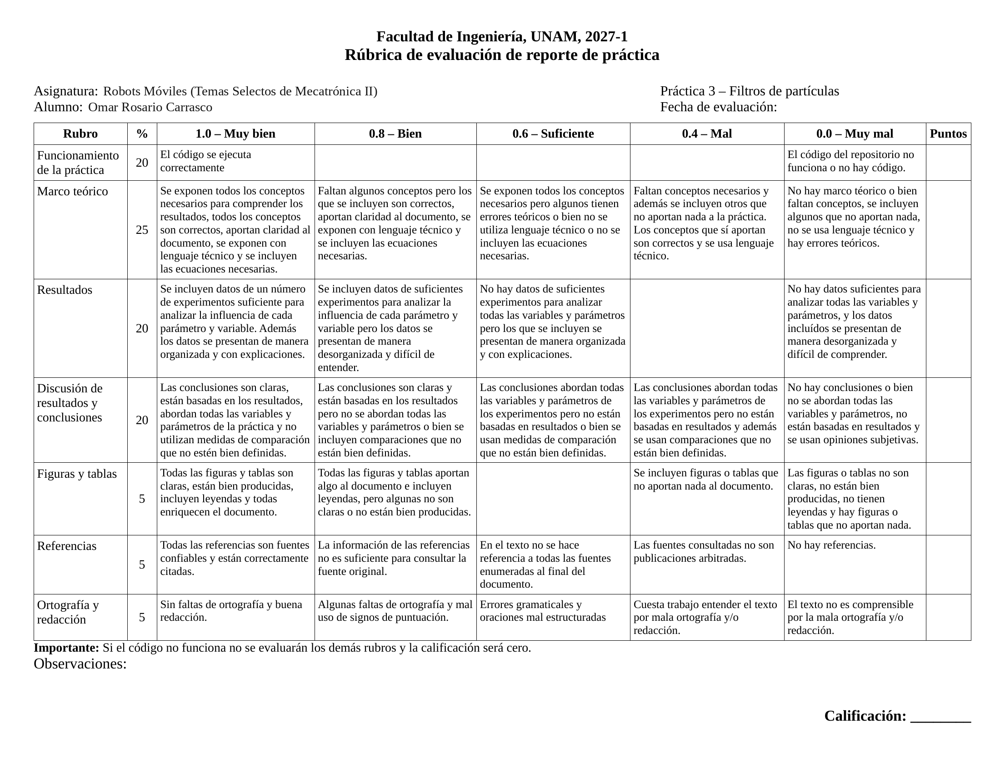
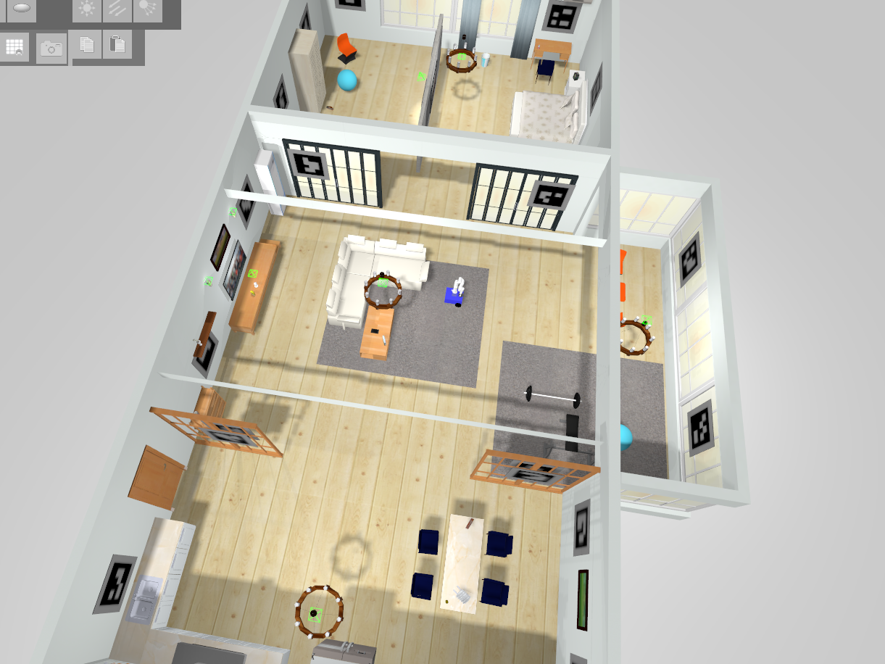

::: {custom-style="RubricaPagina"}
{width=24.4cm}
:::

::: {custom-style="PortadaInst"}
UNIVERSIDAD NACIONAL AUTÓNOMA DE MÉXICO
:::

::: {custom-style="PortadaFac"}
Facultad de Ingeniería
:::

::: {custom-style="PortadaCurso"}
Robots Móviles (Temas Selectos de Mecatrónica II) · Semestre 2027-1
:::

::: {custom-style="Titulo"}
Práctica 3. Localización por filtros de partículas
:::

::: {custom-style="Subtitulo"}
Efecto del número de partículas y de las varianzas de sensor, movimiento y remuestreo en la localización global de una base diferencial con ROS 2 y Gazebo
:::

::: {custom-style="PortadaDatos"}
**Alumno:** Omar Rosario Carrasco\
**Profesor:** Dr. Marco Negrete\
**Fecha:** 22 de octubre de 2026
:::

::: {custom-style="ResumenTitulo"}
Resumen
:::

::: {custom-style="ResumenTexto"}
Se evaluó un filtro de partículas para la localización global de una base diferencial con lídar en una casa simulada con ROS 2 Jazzy y Gazebo. Se implementaron la distribución inicial uniforme, el modelo de movimiento con ruido gaussiano, la similitud entre la lectura real y las simuladas por trazado de rayos, y el remuestreo por ruleta con ruido. A partir de una configuración base (*N* = 1000, *σ*~s~^2^ = 0.1, *σ*~m~^2^ = *σ*~r~^2^ = 0.01) se varió un parámetro a la vez y se hicieron 28 corridas automatizadas (14 configuraciones, dos repeticiones), en las que se midieron la iteración de localización, el error final y el tiempo por iteración. La varianza del sensor controló la rapidez: con *σ*~s~^2^ = 1 la localización tardó 15 a 16 iteraciones, contra 2 a 3 con 0.01. Con *N* = 100 una de las dos corridas convergió a una hipótesis falsa, y el costo creció linealmente con *N* (≈ 0.03 ms por partícula). Las varianzas de movimiento y de remuestreo de 1 elevaron el error final de 0.14 m a 0.20–0.22 m. El comando sugerido en la práctica (*N* = 100 y varianzas de 1) no se localizó en ninguna corrida. También se identificó un sesgo de 0.16 m hacia adelante en la pose estimada, porque el filtro simula las lecturas desde la pose de la partícula y no desde la del lídar.
:::

# 1. Introducción

**Contexto.** Un robot móvil necesita conocer su pose *q* = (*x*, *y*, *θ*) para planear y seguir rutas. Integrar la odometría no basta: la pose inicial puede ser desconocida y cada movimiento agrega error, de modo que la incertidumbre crece sin límite. La localización consiste en estimar la pose a partir de un mapa, de las lecturas de los sensores y del historial de movimientos [[siegwart|§5.6]]. Cuando la pose inicial es desconocida se habla de localización global, el caso más difícil [[thrun05|cap. 7]]. Los filtros de partículas, conocidos en este contexto como localización Monte Carlo (MCL), resuelven la localización global representando la creencia sobre la pose con un conjunto de muestras en lugar de una distribución gaussiana [[dellaert]], [[thrun05|cap. 8]].

**Planteamiento del problema.** Una base diferencial con un lídar planar se encuentra en una casa simulada cuyo mapa de celdas de ocupación es conocido. El robot no conoce su pose inicial. Con el filtro de partículas implementado en la práctica se debe estimar su pose conforme se desplaza, y determinar cómo influyen los cuatro parámetros del filtro en la rapidez y la exactitud de la localización: el número de partículas *N* y las varianzas del sensor *σ*~s~^2^, del movimiento *σ*~m~^2^ y del remuestreo *σ*~r~^2^.

**Objetivos.** El objetivo general es comparar el desempeño de un filtro de partículas sintonizado con diferentes parámetros. Los objetivos particulares son: (1) implementar las funciones del filtro (distribución inicial, movimiento de partículas, medida de similitud, selección aleatoria y remuestreo); (2) diseñar experimentos repetibles en los que se varía un parámetro a la vez; (3) definir medidas cuantitativas de comparación (iteraciones hasta localizarse, error final y tiempo de cómputo); y (4) explicar los resultados con el marco teórico.

La sección 2 presenta el marco teórico, la sección 3 describe la plataforma, la implementación y el diseño de los experimentos, la sección 4 reporta y discute los resultados y la sección 5 presenta las conclusiones.

# 2. Marco teórico

## 2.1 Localización probabilística y filtro Bayesiano

En la localización probabilística no se mantiene una sola estimación de la pose, sino una distribución de probabilidad sobre todas las poses posibles, llamada creencia, *bel*(*x*~t~) = *p*(*x*~t~ | *z*~1:t~, *u*~1:t~), donde *z*~1:t~ son las mediciones y *u*~1:t~ los controles hasta el instante *t* [[thrun05|cap. 2]]. Bajo la suposición de Markov (el estado actual resume toda la historia), la creencia se calcula de forma recursiva con el filtro Bayesiano, que alterna dos pasos [[thrun05|cap. 2]], [[siegwart|§5.6.2, ecs. (5.21)–(5.22)]], [[choset|§9.1.2]]. El paso de predicción incorpora el control *u*~t~ mediante el modelo de movimiento *p*(*x*~t~ | *u*~t~, *x*~t−1~):

::: {custom-style="Ecuacion"}
§T $\overline{\text{bel}}(x_t)=\int p(x_t\mid u_t,\,x_{t-1})\;\text{bel}(x_{t-1})\,dx_{t-1}$ §T{{eq:pred}}
:::

y el paso de corrección incorpora la medición *z*~t~ mediante el modelo de observación *p*(*z*~t~ | *x*~t~), que es la verosimilitud de la lectura del sensor en cada pose:

::: {custom-style="Ecuacion"}
§T $\text{bel}(x_t)=\eta\;p(z_t\mid x_t)\;\overline{\text{bel}}(x_t)$ §T{{eq:corr}}
:::

donde *η* es una constante de normalización. Es la regla de Bayes: la predicción hace las veces de probabilidad a priori, *p*(*z*~t~ | *x*~t~) es la verosimilitud y *bel*(*x*~t~) es la probabilidad a posteriori. Al moverse, la creencia se ensancha; al medir, se concentra en las poses compatibles con la lectura.

## 2.2 Filtro de partículas (localización Monte Carlo)

El filtro de partículas es una implementación no paramétrica del filtro Bayesiano: aproxima *bel*(*x*~t~) con un conjunto de *N* muestras o partículas, cada una una hipótesis de la pose [[thrun05|cap. 4]], [[choset|§9.1.4]]:

::: {custom-style="Ecuacion"}
§T $\mathcal{X}_t=\{x_t^{[1]},\,x_t^{[2]},\,\dots,\,x_t^{[N]}\},\qquad x_t^{[m]}=\big(x^{[m]},\,y^{[m]},\,\theta^{[m]}\big)$ §T{{eq:set}}
:::

Mientras más denso es el conjunto en una región, más probable es que la pose real esté ahí. A diferencia del filtro de Kalman extendido, no supone una distribución normal, por lo que puede representar varias hipótesis a la vez; esto es lo que permite la localización global [[dellaert]]. Cada iteración consta de tres pasos [[thrun05|cap. 4]], [[choset|alg. 17, p. 317]]:

1. *Muestreo del modelo de movimiento* (predicción): cada partícula se mueve según el control con ruido, $x_t^{[m]}\sim p(x_t\mid u_t,x_{t-1}^{[m]})$.
2. *Ponderación* (corrección): a cada partícula se le asigna un peso o factor de importancia proporcional a la verosimilitud de la medición, $w_t^{[m]}=\eta\,p(z_t\mid x_t^{[m]})$, con $\sum_m w_t^{[m]}=1$.
3. *Remuestreo con reemplazo*: se extraen *N* partículas del conjunto anterior; la probabilidad de extraer la partícula *m* es su peso. Las hipótesis con peso alto se duplican y las de peso bajo desaparecen, de modo que el nuevo conjunto queda distribuido aproximadamente según *bel*(*x*~t~).

En la localización global la distribución inicial es uniforme sobre la región donde puede estar el robot [[thrun05|cap. 8]]:

::: {custom-style="Ecuacion"}
§T $x_0^{[m]}\sim\mathcal{U}\big([x_{\min},x_{\max}]\times[y_{\min},y_{\max}]\times[\theta_{\min},\theta_{\max}]\big)$ §T{{eq:init}}
:::

La pose estimada se obtiene como la media de las partículas. Para la orientación se usa la media circular, porque el promedio directo de ángulos falla cerca de ±π:

::: {custom-style="Ecuacion"}
§T $\hat{x}=\dfrac{1}{N}\sum_{m}x^{[m]},\qquad \hat{y}=\dfrac{1}{N}\sum_{m}y^{[m]},\qquad \hat{\theta}=\operatorname{atan2}\Big(\sum_{m}\sin\theta^{[m]},\;\sum_{m}\cos\theta^{[m]}\Big)$ §T{{eq:est}}
:::

## 2.3 Modelo de movimiento

La odometría entrega el desplazamiento del robot (Δ*x*, Δ*y*, Δ*θ*) expresado en el sistema del robot. Para mover cada partícula, el desplazamiento se rota con la orientación de la partícula y se le suma ruido gaussiano *n* de media cero y varianza *σ*~m~^2^, que modela la incertidumbre del movimiento:

::: {custom-style="Ecuacion"}
§T $x^{[m]}\leftarrow x^{[m]}+\Delta x\cos\theta^{[m]}-\Delta y\sin\theta^{[m]}+n_x$
:::

::: {custom-style="Ecuacion"}
§T $y^{[m]}\leftarrow y^{[m]}+\Delta x\sin\theta^{[m]}+\Delta y\cos\theta^{[m]}+n_y$
:::

::: {custom-style="Ecuacion"}
§T $\theta^{[m]}\leftarrow\theta^{[m]}+\Delta\theta+n_\theta$ §T{{eq:motion}}
:::

con *n*~x~, *n*~y~, *n*~θ~ ∼ *N*(0, *σ*~m~^2^). Es una versión simplificada de los modelos de odometría de la literatura, en los que la desviación del ruido crece con la magnitud de la traslación y de los giros [[choset|pp. 318–319]], [[thrun05|cap. 5]]; aquí la varianza es constante e igual en las tres componentes. El ruido de movimiento cumple además una función práctica: dispersa las partículas y les permite explorar poses cercanas que el conjunto actual no contiene.

## 2.4 Modelo de observación y medida de similitud

Para cada partícula se simula la lectura que daría el lídar si el robot estuviera en esa pose. La simulación se hace por trazado de rayos (*ray tracing*) sobre el mapa de celdas de ocupación: cada rayo avanza celda por celda hasta encontrar una celda ocupada o rebasar el alcance máximo. Como esta simulación es costosa, solo se simula uno de cada *D* rayos del sensor real (submuestreo). La lectura simulada de la partícula *p* se compara con la real mediante la media de las diferencias absolutas:

::: {custom-style="Ecuacion"}
§T $\delta_p=\dfrac{1}{M}\sum_{i=0}^{M-1}\left|\,d^{\,r}_{D i}-d^{\,s}_{p,i}\,\right|$ §T{{eq:delta}}
:::

donde $d^{\,r}_{D i}$ es la (*D*·*i*)-ésima lectura real, $d^{\,s}_{p,i}$ la *i*-ésima lectura simulada de la partícula y *M* el número de pares comparados; se omiten los pares en los que alguna lectura no es finita. La diferencia se convierte en similitud con una exponencial y las similitudes se normalizan para usarlas como distribución de probabilidad:

::: {custom-style="Ecuacion"}
§T $s_p=e^{-\delta_p/\sigma_s^{2}},\qquad w_p=\dfrac{s_p}{\sum_{q=1}^{N}s_q}$ §T{{eq:sim}}
:::

La varianza del sensor *σ*~s~^2^ actúa como una temperatura. El cociente de pesos entre dos partículas,

::: {custom-style="Ecuacion"}
§T $\dfrac{w_a}{w_b}=\exp\!\left(-\dfrac{\delta_a-\delta_b}{\sigma_s^{2}}\right)$ §T{{eq:ratio}}
:::

muestra que con *σ*~s~^2^ pequeña una diferencia de pocos centímetros en *δ* separa mucho los pesos (selección agresiva), y con *σ*~s~^2^ grande todas las partículas pesan casi lo mismo. Esta medida es una versión simplificada del modelo de haz (*beam model*), que mezcla una gaussiana alrededor de la distancia esperada con términos para obstáculos no modelados, fallas y lecturas aleatorias [[thrun05|cap. 6]]. Thrun *et al.* señalan que suponer en el modelo de observación más ruido del que realmente tiene el sensor suele hacer al filtro más robusto [[thrun05|cap. 4]].

## 2.5 Remuestreo con reemplazo

Para elegir una partícula con la probabilidad dada por los pesos se usa la ruleta, o inversión de la función de distribución acumulada: se genera *ρ* ∼ *U*\[0, 1) y se elige el menor índice *i* tal que

::: {custom-style="Ecuacion"}
§T $\sum_{j=1}^{i}w_j\;\ge\;\rho$ §T{{eq:roulette}}
:::

Cada elección cuesta *O*(*N*) y el remuestreo completo *O*(*N*^2^). El muestreo sistemático (de baja varianza) obtiene las *N* partículas en *O*(*N*) con un solo número aleatorio [[choset|alg. 18, p. 318]], [[thrun05|cap. 4]]. Como el remuestreo duplica partículas, a cada partícula elegida se le suma ruido gaussiano de varianza *σ*~r~^2^:

::: {custom-style="Ecuacion"}
§T $x^{[m]}\leftarrow x^{[i]}+n,\qquad n\sim\mathcal{N}\big(0,\;\sigma_r^{2}I_3\big)$ §T{{eq:rough}}
:::

Este paso corresponde al *roughening* que propusieron Gordon, Salmond y Smith en el filtro *bootstrap*: agregar una perturbación independiente a cada muestra remuestreada para conservar la diversidad del conjunto [[gordon]].

## 2.6 Fuentes de error y efecto esperado de los parámetros

El filtro de partículas tiene errores de aproximación propios [[thrun05|cap. 4]]: (i) con *N* finito la aproximación de *bel*(*x*~t~) es sesgada y mejora conforme *N* crece; (ii) el remuestreo aleatorio reduce la diversidad del conjunto, lo que aumenta la varianza del estimador; (iii) si la verosimilitud es muy estrecha, casi ninguna partícula recibe peso apreciable; y (iv) puede ocurrir privación de partículas: puede no quedar ninguna partícula cerca de la pose real, ya sea porque *N* es pequeño respecto a la región de búsqueda o por una serie desafortunada de remuestreos, y entonces el filtro no puede recuperarse por sí solo. El costo de una iteración está dominado por el trazado de rayos y es proporcional a *N* · *M* · *L*, donde *L* es el número de celdas que recorre cada rayo. Con estas ideas, la {{tabref:efectos}} resume el efecto esperado de cada parámetro.

Table: **Tabla {{tab:efectos}}.** Efecto esperado de los parámetros del filtro (hipótesis que se contrastan en la sección 4).

{{TAB:efectos}}

# 3. Desarrollo

## 3.1 Plataforma de pruebas

Los experimentos se hicieron en simulación con ROS 2 Jazzy [[macenski]] y Gazebo Harmonic [[koenig]], dentro de un contenedor Ubuntu 24.04 (distrobox) en una computadora con APU AMD Van Gogh (cuatro núcleos Zen 2). El mundo es la casa del paquete `house_simul` ({{figref:gazebo}}) y el robot es una base diferencial con un brazo xArm. El lídar está montado 0.165 m delante del centro de la base (`base_link`), el eje de las ruedas motrices está 0.145 m delante, y el lídar tiene 480 haces en ±120°, un alcance de 0.1 a 10 m y ruido gaussiano de 0.02 m de desviación estándar. El mapa (`appartment`) es una rejilla de 577 × 426 celdas de 0.05 m (28.9 × 21.3 m) servida por `map_server`. El nodo `pf` (paquete `particle_filter`) recibe el mapa, el lídar (`/scan`) y la odometría (transformación `odom → base_link`), y publica las partículas y la transformación `map → odom`; la GUI del curso mueve al robot y RViz2 muestra las partículas y las lecturas del lídar sobre el mapa.

{width=11cm}

## 3.2 Implementación

Las funciones de `ParticleFilter.h` se implementaron siguiendo la sección 2:

* `get_initial_distribution`: *N* poses uniformes en *x* ∈ \[−5, 12\] m, *y* ∈ \[−4, 4\] m y *θ* ∈ \[−3.14, 3.14\] rad ({{eqref:init}}).
* `move_particles`: rotación del desplazamiento de la odometría y ruido gaussiano en *x*, *y* y *θ* ({{eqref:motion}}). La función `gaussian` de la biblioteca `random_numbers` recibe la desviación estándar, así que se le pasa $\sqrt{\sigma_m^2}$ para que el parámetro sea efectivamente una varianza.
* `simulate_particle_scans`: lectura simulada por trazado de rayos; si una partícula cae fuera del mapa, el trazador lanza una excepción, y en ese caso la partícula recibe similitud cero en lugar de detener el nodo.
* `get_particle_similarities`: {{eqref:delta}} y {{eqref:sim}}, omitiendo los pares con lecturas no finitas. Antes de la exponencial se resta el *δ* mínimo, lo que no cambia los pesos normalizados pero evita que todas las similitudes se vuelvan cero por subdesbordamiento cuando ninguna partícula se parece a la lectura real.
* `random_choice` y `resample_particles`: ruleta ({{eqref:roulette}}) y remuestreo con ruido de varianza *σ*~r~^2^ ({{eqref:rough}}).

El nodo ejecuta una iteración del filtro cada vez que la odometría acumula más de 0.2 m de traslación o 0.2 rad de giro, y simula uno de cada *D* = 10 haces (49 rayos por partícula). Estos valores y la región inicial se mantuvieron fijos en todos los experimentos.

## 3.3 Diseño de experimentos

Se tomó como base la configuración con la que el filtro se localizó en las pruebas manuales (*N* = 1000, *σ*~s~^2^ = 0.1, *σ*~m~^2^ = *σ*~r~^2^ = 0.01) y se varió un parámetro a la vez, dejando los demás en su valor base. También se probó el comando que trae la práctica (D0). La {{tabref:diseno}} resume las 14 configuraciones.

Table: **Tabla {{tab:diseno}}.** Configuraciones probadas. Cada fila varía un parámetro respecto a la base; D0 es el comando sugerido en la práctica.

{{TAB:diseno}}

Para que todas las corridas fueran comparables se automatizaron con un script (`practica3/scripts/p3_runner.py`). En cada corrida el script: (1) lleva al robot a la pose inicial (0, 0, 0) usando la pose real de Gazebo; (2) lanza el nodo `pf` con los parámetros de la configuración; (3) mueve al robot siempre con la misma secuencia de desplazamientos pequeños por `/cmd_vel`, igual que la GUI: avance de 1.5 m en pasos de 0.25 m, giro de 180° en pasos de 15°, regreso al origen y otro giro de 180° (36 desplazamientos); y (4) guarda la salida del nodo, que en cada iteración imprime la pose estimada y la pose real tomada del simulador. Como el filtro es estocástico, cada configuración se corrió dos veces, con una semilla aleatoria distinta en cada corrida.

## 3.4 Medidas de comparación

En cada iteración *k* se calculan el error de posición y el error de orientación entre la pose estimada ({{eqref:est}}) y la real:

::: {custom-style="Ecuacion"}
§T $e_d=\sqrt{(\hat{x}-x)^2+(\hat{y}-y)^2},\qquad e_\theta=\left|\operatorname{wrap}(\hat{\theta}-\theta)\right|$ §T{{eq:err}}
:::

donde wrap(·) lleva el ángulo a (−π, π\]. Se considera que el robot está localizado en la iteración *k*\* si *e*~d~ < 0.3 m y *e*~θ~ < 0.2 rad durante tres iteraciones consecutivas, a partir de *k*\*. El umbral de posición toma en cuenta un sesgo de la implementación: el lídar real está 0.165 m delante de `base_link`, pero el filtro simula las lecturas desde la pose de cada partícula. La nube converge entonces al punto desde el que se mide, y aun con el robot bien localizado se espera un error de posición residual cercano a 0.165 m. Las medidas de comparación son:

* **Rapidez de convergencia:** *k*\*, el número de iteraciones del filtro que tarda en localizarse (una por cada 0.2 m o 0.2 rad de desplazamiento), y la fracción de corridas que se localizaron.
* **Exactitud final:** *ē*~d~ y *ē*~θ~, promedios de *e*~d~ y *e*~θ~ en las últimas 10 iteraciones de cada corrida.
* **Costo de cómputo:** *t*~it~, tiempo medio de una iteración del filtro (mover, simular, ponderar y remuestrear), medido con las marcas de tiempo del registro del nodo.

# 4. Resultados

## 4.1 Comportamiento observado

La {{figref:rviz}} muestra en RViz2 el aspecto típico de los dos extremos. Con el comando sugerido en la práctica (D0, varianzas de 1), la nube de partículas sigue repartida por la casa después de varios desplazamientos y las lecturas del lídar (rojo) no coinciden con las paredes: el robot no está localizado. Con la configuración base, la nube se reduce a un grupo compacto alrededor del robot y las lecturas del lídar caen sobre las paredes del mapa.

{width=16cm}

## 4.2 Resumen de los experimentos

Se hicieron 28 corridas (14 configuraciones × 2 repeticiones), cada una de 43 a 45 iteraciones del filtro. La {{tabref:resultados}} resume, para cada configuración, cuántas corridas se localizaron, en qué iteración, la exactitud final y el tiempo de cómputo por iteración. La {{figref:conv}} muestra la evolución del error de posición en cada barrido.

Table: **Tabla {{tab:resultados}}.** Resultados por configuración (dos corridas cada una). *Localizó*: corridas que cumplieron el criterio de la sección 3.4. *k*\* *por corrida*: iteración en que se localizó cada corrida (– si no se localizó). *k̄*\*: promedio de las corridas localizadas. *ē*~d~ y *ē*~θ~: errores medios de las últimas 10 iteraciones, promediados sobre las corridas localizadas (sobre todas si ninguna se localizó). *t*~it~: tiempo medio de una iteración. En negritas, la configuración base.

{{TAB:resultados}}

{width=15.5cm}

## 4.3 Efecto de cada parámetro

**Número de partículas.** Con *N* = 3000 las dos corridas se localizaron en la primera iteración, y con *N* = 300, en la tercera. Con *N* = 100 solo se localizó una. En la otra, la nube convergió desde el inicio a una hipótesis falsa girada casi 180° (*e*~θ~ ≈ 3 rad en toda la corrida) y terminó a 6.6 m del robot: es la privación de partículas de la sección 2.6. Con 100 partículas hay en promedio una por cada 1.4 m² de la región inicial, y una vez que el remuestreo concentró el conjunto en la hipótesis falsa, el ruido de remuestreo (*σ*~r~ = 0.1 m) no alcanzaba para llegar a la pose real, a varios metros. Con *N* = 1000, una corrida se localizó en la iteración 1 y la otra en la 14. En esta última, durante 13 iteraciones la estimación estuvo a 0.9–4 m y 1–2 rad de la pose real, y en la iteración 14, a la mitad del primer giro, saltó 3.3 m hasta la pose real. Como el ruido de movimiento y el de remuestreo solo desplazan las partículas unos 0.1 m por iteración, el salto indica que la nube conservaba partículas cerca de la pose real: las lecturas tomadas durante el giro las favorecieron y el remuestreo descartó la hipótesis falsa. Una vez localizado el robot, *N* no cambió la exactitud (*ē*~d~ de 0.13 a 0.14 m). El tiempo por iteración creció en proporción a *N* (3.2, 9.1, 29.7 y 91.0 ms; ≈ 0.030 ms por partícula en los cuatro casos), lo que indica que el costo lo domina el trazado de rayos y que el término *O*(*N*^2^) de la ruleta todavía es pequeño con estos valores de *N*.

**Varianza del sensor.** Es el parámetro con el efecto más claro sobre la rapidez. Con *σ*~s~^2^ = 0.01 y 0.1 el filtro se localizó en 1 a 3 iteraciones (salvo la segunda corrida de la base, ya comentada), con 0.5 en 7 y 9, y con 1 en 15 y 16. La {{eqref:ratio}} lo explica: si la lectura simulada de una partícula difiere en promedio 0.1 m más que la de otra, su peso relativo es 0.37 con *σ*~s~^2^ = 0.1, pero 0.90 con *σ*~s~^2^ = 1. Con pesos tan parejos el remuestreo casi no selecciona y la nube se contrae poco a poco: en S3 el error bajó de 2 m a 0.4–0.5 m en las primeras 8 iteraciones y no cruzó el umbral sino hasta la iteración 15 o 16 ({{figref:conv}}). La exactitud de posición final casi no cambió (*ē*~d~ de 0.14 a 0.15 m), pero el error de orientación aumentó de 0.007 a 0.017 rad. Con *σ*~s~^2^ = 0.01 el peso relativo del mismo ejemplo es 4.5 × 10^−5^: la selección es muy agresiva y, aunque en estas dos corridas no hubo fallas, es la configuración más expuesta a quedarse con una hipótesis falsa ({{tabref:efectos}}).

**Varianza del ruido de movimiento.** Las corridas M1 a M3 se localizaron todas, en 1 a 5 iteraciones, sin una tendencia clara en *k*\*. El efecto está en la exactitud: con *σ*~m~^2^ = 1, es decir, una desviación estándar de 1 m y 1 rad en cada predicción, el error final subió a 0.22 m y 0.025 rad, contra 0.14–0.15 m y ≤ 0.011 rad con los demás valores, y la curva de error es más irregular ({{figref:conv}}). El filtro se sigue localizando porque, con *σ*~s~^2^ = 0.1, la corrección descarta casi todas las partículas que el ruido aleja y el remuestreo vuelve a concentrar la nube en cada iteración; lo que se pierde es precisión, porque la nube nunca llega a estar tan concentrada. Con *σ*~m~^2^ = 0.001 una corrida tardó 5 iteraciones, lo que concuerda con la menor exploración esperada, aunque con dos corridas la diferencia no es concluyente.

**Varianza del ruido de remuestreo.** Las corridas R1 a R3 también se localizaron todas. Con *σ*~r~^2^ = 0.001 la localización tardó 4 y 5 iteraciones, y con 0.1 y 1, de 2 a 3: más ruido de remuestreo conserva más diversidad en la nube, que es el propósito del *roughening* [[gordon]]. El precio es la exactitud: con *σ*~r~^2^ = 1 el error final subió a 0.20 m y el de orientación a 0.037 rad, el mayor de todas las configuraciones localizadas, porque cada copia se aleja de la partícula original con una desviación estándar de 1 m y 1 rad y la nube no termina de concentrarse. Con *σ*~r~^2^ = 0.1 el error de posición fue el de la base (0.14 m) y el de orientación, el doble (0.015 rad).

**Comando de la práctica.** Ninguna de las dos corridas se localizó. El error de posición osciló entre 0.2 y 4.8 m sin tendencia a disminuir, y el error final fue de 2.84 m y 0.90 rad ({{figref:evr}}, derecha). En esta configuración se juntan los tres efectos desfavorables: pocas partículas para la región inicial (como en N1), pesos poco selectivos (como en S3) y, con *σ*~m~^2^ = *σ*~r~^2^ = 1, una dispersión de más de un metro en cada iteración, mayor que la que la corrección alcanza a concentrar. Es lo que se ve en la {{figref:rviz}}a: la nube sigue repartida por la casa. Ninguna de las configuraciones con un solo parámetro desfavorable falló en las dos corridas, de modo que estos efectos se refuerzan entre sí.

## 4.4 Convergencia de la pose estimada a la real

La {{figref:evr}} compara, iteración por iteración, la pose estimada con la pose real de Gazebo para una corrida de la configuración base y una del comando de la práctica. La {{figref:mapa}} muestra las mismas corridas en el plano. La {{tabref:poses}} registra la pose estimada y la real en la última iteración de la primera corrida de cada configuración; todas las iteraciones de todas las corridas están en `practica3/resultados/iteraciones.csv`.

![**Figura {{fig:evr}}.** Pose estimada (media de las partículas, naranja) y pose real tomada del simulador (azul) en función de la iteración. Izquierda: configuración base, primera corrida; la línea punteada marca la iteración de localización *k*\*. Derecha: comando de la práctica, que no se localiza. Los ángulos se muestran sin envolver para evitar los saltos en ±π. En los giros en el lugar (*k* ≈ 8–21 y 30–43) la posición real describe un arco de ≈ 0.15 m de radio porque *base_link* está 0.145 m detrás del eje de las ruedas, sobre el que gira el robot; la estimación, que sigue al lídar, casi no se mueve.](fig/fig_estimada_vs_real.png){width=14cm}

{width=15.5cm}

Table: **Tabla {{tab:poses}}.** Pose estimada y pose real en la última iteración (*k*) de la primera corrida de cada configuración, y errores correspondientes. En negritas, la configuración base.

{{TAB:poses}}

Salvo M3 y R3, todas las configuraciones localizadas terminaron con un error de posición de 0.13 a 0.16 m, independiente del parámetro que se varió. Al proyectar el error sobre la orientación real del robot, en las 25 corridas localizadas el error medio a partir de *k*\* es de 0.156 ± 0.021 m hacia adelante y de −0.002 ± 0.012 m hacia los lados (media ± desviación estándar entre corridas). Es el sesgo previsto en la sección 3.4: el filtro simula las lecturas desde la pose de cada partícula, de modo que estima la pose del lídar, 0.165 m delante de `base_link`, mientras que el simulador reporta la pose de `base_link`. Por eso, en la {{tabref:poses}}, donde el robot mira casi hacia +*x*, la *x* estimada supera a la real en todas las configuraciones localizadas. Si el error se mide respecto a la posición del lídar, el error final de la base baja de 0.14 m a 0.08 m. El mismo efecto explica que en los giros la estimación casi no se mueva mientras la pose real describe un arco ({{figref:evr}}): el robot gira sobre el eje de sus ruedas, que está a solo 0.02 m del lídar, pero a 0.145 m de `base_link`.

# 5. Conclusiones

Las comparaciones usan las medidas de la sección 3.4: una configuración converge más rápido si su *k*\* es menor, es más confiable si se localiza en más corridas, es más exacta si *ē*~d~ y *ē*~θ~ son menores y es más barata si *t*~it~ es menor. Con ellas, los resultados concuerdan con lo esperado en la {{tabref:efectos}}:

1. **Número de partículas.** *N* determina la confiabilidad de la localización global y el costo, pero no la exactitud. Con *N* = 100 una de las dos corridas quedó atrapada en una hipótesis falsa por privación de partículas; con *N* ≥ 300 se localizaron todas, y con *N* = 3000, desde la primera iteración. Las corridas localizadas tuvieron el mismo error final (0.13–0.14 m) con cualquier *N*, mientras que *t*~it~ creció linealmente, ≈ 0.03 ms por partícula.
2. **Varianza del sensor.** *σ*~s~^2^ controla la rapidez de convergencia porque fija qué tan selectivos son los pesos ({{eqref:ratio}}): *k*\* pasó de 2–3 iteraciones con 0.01 a 7–9 con 0.5 y a 15–16 con 1, con casi la misma exactitud final. Con 0.01 no hubo fallas, pero dos corridas no bastan para descartar que una selección tan agresiva se quede con una hipótesis falsa.
3. **Ruido de movimiento y de remuestreo.** *σ*~m~^2^ y *σ*~r~^2^ tienen efectos parecidos. Con 1, el filtro se localizó igual de rápido, pero su exactitud empeoró de 0.14 m y 0.007 rad a 0.20–0.22 m y 0.025–0.037 rad, porque la nube no termina de concentrarse. Con 0.001 la convergencia fue algo más lenta (*k*\* de hasta 4–5), como se espera de una menor exploración y diversidad, aunque la diferencia es comparable a la variación entre corridas. Los valores de 0.01 a 0.1 dieron el mejor compromiso. Las varianzas casi no cambiaron el costo (*t*~it~ de 27.9 a 30.5 ms con *N* = 1000).
4. **Combinación de parámetros.** El comando de la práctica (*N* = 100 y varianzas de 1) no se localizó en ninguna corrida (error final de 2.84 m), mientras que ninguna configuración con un solo parámetro desfavorable falló en ambas corridas: los efectos de pocas partículas, pesos poco selectivos y ruido grande se refuerzan.
5. **Sesgo de la implementación.** El error residual de ≈ 0.14 m de las corridas localizadas no depende de los parámetros: el filtro estima la pose del lídar, que está 0.165 m delante de `base_link`, y el sesgo medido fue de 0.156 ± 0.021 m. Simular las lecturas desde la pose del sensor, con la transformación `base_link → laser_link`, lo eliminaría.

Para este mapa y esta secuencia de movimientos, la configuración base es un buen compromiso: se localizó en todas sus corridas, con un error final de 0.14 m y 0.007 rad, a ≈ 30 ms por iteración; con *N* = 3000 se localiza antes, pero cuesta el triple. Como trabajo futuro quedan corregir el sesgo del sensor, usar el remuestreo sistemático, que reduce el costo del remuestreo a *O*(*N*) [[choset|alg. 18, p. 318]], y hacer más repeticiones por configuración para estimar la variabilidad con más confianza.

# Referencias

{{REFS}}
